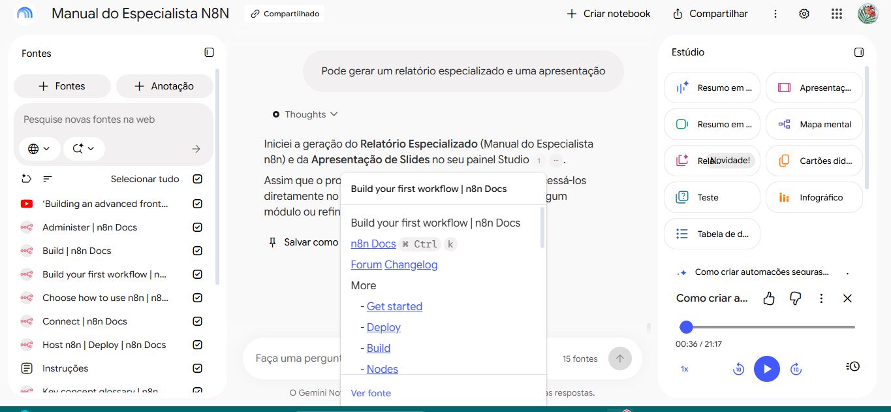

# Notebook LM (Agora Gemini LM) - Guia de Estudos sobre N8N

## 🎯 Tema e Objetivo

Montar um segundo cérebro sobre N8N para iniciantes, reunindo fontes oficiais e confiáveis que explicam conceitos básicos e workflows simples.

## 📚 Fontes utilizadas e justificativas
**1. Documentação oficial do N8N**

Confiável porque é mantida pelos desenvolvedores e explica passo a passo a instalação e primeiros workflows.
  - https://docs.n8n.io/choose-how-to-use-n8n
  - https://docs.n8n.io/build-your-first-workflow
  - https://docs.n8n.io/key-concept-glossary
  - https://docs.n8n.io/n8n-community-license/community-license/license-faq
  - https://docs.n8n.io/deploy/host-n8n
  - https://docs.n8n.io/deploy/use-n8n-cloud
  - https://docs.n8n.io/build
  - https://docs.n8n.io/integrations
  - https://docs.n8n.io/integrations/builtin/node-types
  - https://docs.n8n.io/connect
  - https://docs.n8n.io/administer

**2. Canal oficial do N8N no YouTube – vídeos**

Confiável porque mostra na prática como montar workflows simples.
  - https://www.youtube.com/watch?v=GuaKeDS6UKU
  - https://www.youtube.com/watch?v=qdk-ip0wmUY

**3. Stackflow - N8N**

Confiável porque é publicado por autores reconhecidos na comunidade N8N, com exemplos validados e feedback de outros usuários
  - https://stackoverflow.com/questions/tagged/n8n?tab=Newest

## 🔗 Link do Notebook LM

  - [link do Notebook LM](https://notebook.google.com/notebook/c0863f75-cb46-43d5-a14b-34d3b9d339bd)

## 📂Materiais Gerados

 - Print do chat mostrando a resposta com a fonte:
   

- Slides em PDF
    [Slides](assets-n8n/relatorio-n8n.pdf)

- 📑 Relatório e 🎧 Áudio acesse o link do notebook LM acima 

